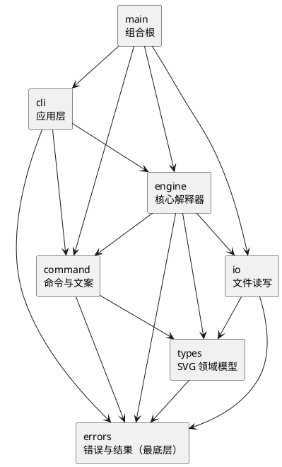

# SVG 编辑器（CLI）— 项目文档

> 本文件是作业要求的交付文档（作业 §1.2：Markdown 格式、位于工程 `doc/` 目录），面向课程评阅。工程的安装、运行与测试方式见仓库根目录 [README.md](../README.md)；正式规格见 [`spec/`](spec/)，架构决策记录见 [`adr/`](adr/)，AI 协作完整记录见 [`../agent/history/`](../agent/history/)。

> 项目地址：<https://github.com/L1nexi/svg-editor-cli>

## 架构方案

本节按作业要求陈述四项结论：模块划分、设计模式、依赖方向规则、变化点假设。各项决策的形成过程与备选方案的取舍见架构决策记录 [`adr/`](adr/)（ADR-0001 至 ADR-0007），本文不再重复。

### 模块划分

源码位于 `src/`，按职责分为六个模块；组装根 `main.ts` 位于模块之外，测试目录 `tests/` 与源码结构镜像。

| 单元           | 职责                                                                                                                                                                                                                                                                                                          |
| -------------- | ------------------------------------------------------------------------------------------------------------------------------------------------------------------------------------------------------------------------------------------------------------------------------------------------------------- |
| `src/main.ts`  | 组合根。位于 src 顶层、不属于任何模块，是唯一允许认识全部模块的位置：注册内置图形类型，装配文件读写实现与 19 条命令的集合，构造引擎并启动 REPL                                                                                                                                                                |
| `src/cli/`     | 应用层。REPL 循环（提示符与横幅输出、空行与注释行处理）、Parser 词法分析（空格切分、双引号包裹、`\"` 转义）与输出装配（警告行先于命令回显）。只消费引擎的执行结果，不参与对象组装                                                                                                                             |
| `src/engine/`  | 核心解释器。Engine 持有命令名到命令对象的注册表并完成分发；Actuator 负责执行前置守卫、按命令类层次路由、装配命令所需的三个状态操作句柄，并实现编辑命令「复制草稿、变异、成功后提交」的执行流程；State 持有撤销时间线与文档来源路径；Timeline 维护状态链并实现 undo/redo。引擎不含 REPL 循环，可被连续投喂命令 |
| `src/command/` | 19 条命令的命令对象与全部回显文案的产地。base 子层为命令抽象层次、三个状态操作句柄接口与载荷数据类，edit/display/document/timeline 四个子层按类别放置具体命令。每条命令以声明式字段描述自身：参数个数表、用法文案、是否要求已建立文档                                                                         |
| `src/types/`   | SVG 领域模型。Shape 抽象基类与 rect、circle、ellipse、line、text、g 六种内置图形构成组合结构；Canvas 持有画布尺寸与根容器；ShapeProvider 与 ShapeFactory 构成图形注册工厂；CoordinateTransform 服务于 SVG 读取时的坐标展开。tree 与 show 所需的类型级显示文本亦在本层以方法形式提供                           |
| `src/io/`      | 文件读写。IoBackend 为注入用接口，FileIoBackend 为产品实现；SvgReader、SvgIds、SvgTransform 分别负责 SVG 解析、id 分配与坐标展开。第三方 XML 库 @xmldom/xmldom 仅在本模块内使用                                                                                                                               |
| `src/errors/`  | 错误对象体系与统一结果类型 `Result<T, E>`。所有 `error:` 文案由错误对象自行 format 产生，错误经返回值传递而不以异常抛出。具体错误类按语义分为 validation（输入不合式）、entity（寻址失败）、hierarchy（树结构关系不满足）、io 四类                                                                            |
| `tests/`       | 与 src 结构镜像的单元测试；`tests/cli/transcript.test.ts` 以真实进程重放作业原文 §6 与 §6.1 的完整会话并逐字比对输出                                                                                                                                                                                          |

模块间的依赖关系如下（箭头由依赖方指向被依赖方）：

### 设计模式的选择

代码使用五个设计模式，逐项说明落地方式与代码落点。

1. **Command（命令模式）**：19 条命令各自封装为命令对象（`src/command/`），以统一的 execute 接口被引擎调用；undo 与 redo 同样是命令对象（`src/command/timeline/`），与其余命令走同一条分发路径。命令对象以类层次与声明式字段自述执行所需的元信息（参数个数表、用法文案、是否要求文档已建立），供引擎在分发前统一校验；每个编辑命令返回携带正向、反向两条回显文案的载荷，与画布快照一同存入时间线，undo 与 redo 沿时间线打印对应方向的文案，无需从快照反推。
2. **Composite（组合模式）**：图形树由抽象基类 Shape 与六个具体图形类构成（`src/types/shapes/`），容器 `<g>` 与叶子图形实现同一接口，move/scale/set/delete 四类操作对二者一视同仁，对容器执行时由其递归作用于全部子孙；Canvas 持有根容器，查找与计数等遍历委托给树。
3. **Memento（备忘录模式）**：撤销系统以状态时间线实现：时间线保存每一步编辑成功后的画布快照（备忘录），undo 与 redo 在快照间前进或后退。编辑命令的执行流程固定为：复制当前画布草稿、在草稿上变异、成功后提交为新快照，失败则丢弃草稿；「失败无副作用」因此成为结构性保证，而非逐处检查的约定。文档类命令使既有撤销历史失效的规则，同样由时间线结构自然表达，无需在命令中散布特判。（`src/engine/` 的 State 与 Timeline）
4. **Factory（工厂模式）**：ShapeFactory（`src/types/base/ShapeFactory.ts`）维护「类型名 → 图形类」的注册表，create 命令与 SVG 读取统一经工厂构造图形；新增图形类型只需注册一个 Provider，为作业后续阶段的插件类型（box）预留了接入点。工厂注册表与命令注册表是全仓库仅有的两处按名字分派，均标注待重构。
5. **Template Method（模板方法）**：`Command.run()`（`src/command/base/Command.ts`）先按命令声明的参数个数表统一校验，再调用子类 execute；参数校验逻辑只实现一次，子类以声明式字段（参数个数表、用法文案）提供数据，漏声明者无法通过编译。

### 依赖方向规则

依赖关系无环、自底向上（完整规则及演化见 ADR-0002 决策三）：

> errors 不依赖任何模块；types → errors；io、command → types；engine → types、io、command；cli → command、engine、errors；main（组合根）→ 全部模块。

各条规则的理由如下：

- errors 位于最底层且不依赖任何模块：它是全体模块共享的错误对象与 Result 词汇，指向任何具体模块的依赖都会引入环。
- types 只依赖 errors：领域模型自足，仅在解析与查找失败处返回 Result；它不认识命令、引擎与文件，新增图形类型因此无需惊动上层。
- command、io 只依赖 types 与 errors：两者都以领域模型为界面，命令对象产出回显文案，文件读写以 Canvas 为出入；彼此无需相见，也就都能独立于引擎测试。
- engine 依赖 command、types、io：它是消费命令抽象、操作领域模型、经 IoBackend 接口使用文件读写的编排层；不依赖 cli，因为 REPL 只是它的消费者之一，脚本或 GUI 同样可以投喂它。
- cli 依赖 engine、command、errors：它把输入交给引擎、把执行结果装配为输出，处在编排的末端，不再被任何模块依赖。
- main 依赖全部模块：这是唯一允许认识全部模块的位置，文件读写实现、命令集合、图形注册等装配知识只存在于组合根。

违反规则的依赖即为待处理项；规则的实际执行情况见下文一致性自查。

### 变化点假设

对未来最可能发生变化的位置，逐一说明预留的机制或放弃预留的理由。

1. **插件图形类型（box）**：作业明示为后续阶段。已预留 ShapeProvider 接口与工厂注册机制作为接入点，接入新类型无需改动 engine 与 cli；SVG 读取侧对携带 data-kind 的 `<g>` 暂按普通容器导入，插件接入后可直接升级。
2. **新增命令**：已预留。每条命令对应一个命令类（自述参数个数、用法文案、是否要求文档），在组合根的命令集合中注册一行即可；撤销单元所需的回显文案由命令自身声明，时间线机制不感知具体命令。若新命令需要新的状态或状态变异能力，State 的原语集与三个状态操作句柄即为预留的扩展位置。
3. **界面替换（GUI、脚本驱动等）**：两层编排（ADR-0006）下，引擎不含 REPL 循环、可被连续投喂，cli 只是引擎的消费者；替换界面只需重写 cli 模块与组合根中的装配代码。
4. **文件格式与解析库**：XML 库隔离在 io 模块内、经 IoBackend 接口注入；SVG 序列化为自行拼接的字符串，转义规则逐字可控。更换解析库或支持新格式只涉及 io 模块。
5. **撤销语义调整**（例如保留 io 命令之前的历史）：改动集中在 Timeline 与 State 的链语义，命令层与回显文案不受影响。
6. **明确不预留的**：性能优化（tree/show 每次全树遍历，作业规模下无性能诉求）；撤销历史持久化（undo/redo 限于会话内）；多文档支持（单画布即作业语义）。此三处未来若需支持则改动面较大，属有意接受的限制。

## 过程记录

开发采用「用户裁决、AI 实施、双向互查」的协作方式：结构性决策先形成架构决策记录（ADR）再改动代码；AI 产出的代码与文档经规范与规格两个维度的复审后合入。以下摘录五个塑造了最终架构的设计讨论，完整记录见 [`../agent/history/`](../agent/history/)。

1. **以备忘录和状态传递承载行为约束**：撤销系统的最初设计逐命令记录逆操作并逐一检查副作用；讨论收敛为备忘录 + 状态传递：时间线保存每步成功后的画布快照，编辑命令在草稿副本上变异、成功才提交。「失败无副作用」与 undo/redo 都由这一结构直接得到，无需逐处检查；文档类命令使撤销历史失效的规则，也只由「时间线截断至链首」一个结构事实承载，不必另设标志。这是本项目「让不变量落在数据结构上」这一取向的起点。
2. **命令显式声明所需能力**：命令需要「读当前画布」「替换文档」「驱动时间线」三类能力，最初方案将全部能力暴露给全部命令；讨论改为命令经类层次与接口显式声明自己完成执行所需的最小能力集，引擎据此装配并路由：编辑类拿到草稿，展示类拿到只读视图，文档类拿到文档替换，撤销类只拿到时间线。副作用面因此按命令类别收敛，能力误用（如展示命令替换文档）在类型层即不可表达。
3. **错误作为一等公民**：错误是显式的值：所有失败以 Rust 风格 `Result<T, E>` 返回，错误对象自身持有文案并负责格式化，一条文案对应一个错误类与一个测试。讨论的起点是代码评审中发现的同一「结果」概念的四种写法，统一后失败路径在类型上可见、逐字可审计；「失败无副作用」也因失败值不携带状态而始终成立。
4. **载荷对象的展示方法之争**：AI 曾在命令返回的载荷对象上增加 lines() 方法、令其自行产出输出行；用户指出这使数据对象反向依赖了展示层的用法，修正为载荷是纯数据（DTO），输出行的装配顺序收敛在 cli 的展示逻辑中。此后同类问题（执行结果是否携带状态、句柄接口按谁的能力划分）都以同一原则裁决：数据不携带行为，行为不越出其所属层。
5. **参数个数校验的声明化**：命令的参数个数最初以「最小/最大个数」两个字段表达，评审中两易其稿：先改为允许个数表，再受 Go iota 启发改为「k 及以上」的区间标记，消除尾端的无上限哨兵值。两次改的都是表达形式，检查位置始终在模板方法里；最终形态是一张声明式数据表，配合模板方法在分发前统一校验。

## 一致性自查

实现完成后，对照架构方案如实回答作业要求的两个问题。

**一、实际目录与方案是否一致？**

一致。实现期间发生三处结构演化，均先修订 ADR 再改动代码，并已记入本文件修订记录：

1. errors 与 command 的内部子层收拢：errors 分为 validation/entity/hierarchy/io 四类，command 分为 base/edit/display/document/timeline 五个子层，方向与方案一致、粒度细化（ADR-0005）；
2. 组合根 main.ts 独立于 cli 模块，产品命令集合独立为 `src/commands.ts`（ADR-0006 修订节）；
3. io 模块从接口缝扩展出真实实现 SvgReader/SvgIds/SvgTransform（ADR-0007）。

其余目录与方案一致。骨架期曾计划将详细方案另立 `spec/architecture.md`，实现后取消该计划：方案正文落在本文件，细节由 ADR 承载，避免同一内容双份维护。

**二、依赖方向规则有没有被违反？**

自查发现并修正规则本身的一处遗漏：原清单未列 cli → errors，而 Repl 判别失败分支需要引用 errors 模块的 `Result` 类型；已修订 ADR-0002 决策三，errors 作为最底层公共依赖允许各模块引用。除此之外，对 `src/` 全量 import 语句进行检查，未发现违反：

- command、types、errors 三个模块中无指向 engine/cli/io 的 import；engine 中无指向 cli 的 import；
- @xmldom/xmldom 仅出现在 `src/io/SvgReader.ts`；
- 具体命令类仅出现在 `src/commands.ts` 与 `src/command/` 内部。

方案中标注待重构的两处按名字分派（命令注册表、图形工厂）维持标注；引擎的四分支 instanceof 路由与 cli 的载荷展示判定属于按类判定与展示判定，为方案内允许的分派方式（ADR-0004 修订节）。已知差异一项：作业 §6.1 流程图样例的 tree 列宽与实现的列宽公式相差 3 列，实现按公式（最大前缀宽与引用宽之和加 2）执行，差异已记入修订记录，必要时向课程组求证。

## 质量保证手段

以下从测试、结构、过程三方面，说明功能完整性与代码质量的依据。

**功能完整性以三层测试确认。** 开发以行为规格（`doc/spec/commands.md`）为准绳、按测试驱动的方式推进：错误类、命令行为与图形语义均以规格表驱动单元测试，文案逐字断言；文件读写以真实临时文件覆盖六种图形的保存与读回、id 补号与重名、坐标展开及文件/XML 失败场景；验收层（`tests/cli/transcript.test.ts`）以真实进程重放作业原文的完整会话并逐字比对输出，检查保存产物。当前 12 个测试文件、167 项测试通过，`npm run typecheck` 通过。

**结构质量以依赖与职责边界保证。** 模块依赖无环、自底向上，一致性自查节以全量 import 检查验证；功能内聚于单一模块（文案产自命令类、状态语义收敛于 State/Timeline、XML 细节不越 io），模块间经窄接口通信，无抽象泄漏：错误文案、输出格式等展示细节均不穿透模块边界。

**过程质量以持续审阅与定期重构保证。** 每个实现批次合入前经代码审阅（规范与规格两个维度的并行复审）；开发全程安排了多轮专门的质量优化与重构（校验逻辑下沉、目录结构收拢、参数校验声明化、编排分层），每次重构以行为与文案零变化为约束、以全量测试为回归防线，过程见修订记录与 [`../agent/history/`](../agent/history/)。

## 修订记录

- 2026-10-25 建立骨架；仓库结构与协作规范见 [`adr/0001-repo-structure.md`](adr/0001-repo-structure.md)；核心架构裁决见 [`adr/0002-core-architecture.md`](adr/0002-core-architecture.md)。
- 2026-10-26 命令层重构（[`adr/0005-src-layout-and-validation.md`](adr/0005-src-layout-and-validation.md)）：src 内部分层收拢（command/base+edit、errors/validation+hierarchy+entity、types/base+shapes）；测试收拢至 `tests/`（修订 ADR-0003 同目录条款）；校验下沉——`Command.run()` 模板方法统一参数个数校验（usage 串成为声明数据），`Canvas.requireShape/requireContainer` 统一 find-or-fail。文案零变化，66 单测绿。
- 2026-10-26 显示类与文档类命令（命令模块收尾）：init/read/save/canvas 落 `command/document/`（init/read 豁免无文档守卫；canvas 无参只读不动时间线），tree/show/help 落 `command/display/`（tree 对齐公式 = max(前缀宽+ref宽)+2，§5.1 样例逐字命中；§6.1 手排差 3 列按公式，记入本自查）；新增 `NoSavePathError`（ADR-0005 后果节留痕归类）。94 单测绿；undo/redo 随 engine 批次。
- 2026-10-26 engine 批次：`engine/`（Engine 注册表/无文档守卫/四分支按类路由 + Timeline 状态链）+ `command/timeline/`（undo/redo 外壳）+ `io/IoBackend`（io 缝契约，构造注入）。时间线重建绑定变更型 env 方法（ADR-0004 修订节）；DocumentEnv.replaceDocument 增 readPath 参数（Q3 文档来源随采纳落定）；UndoableCommand.run 收窄 Result&lt;EditPayload&gt;。命令层 19/19 全部落地，112 单测绿。
- 2026-10-26 编排分层（[`adr/0006-orchestration-layers.md`](adr/0006-orchestration-layers.md)）：两层编排模型（Engine 核心解释器 / 应用层 REPL）；engine 内部四对象 Engine（字符串到 Command 的符号表）→ Actuator（Command 的知识：守卫/路由/Handler 装配/流程）→ State（纯内部状态管理，不触 io）→ Timeline（只组织链）；三个 *Env 更名 *Handler；命令集装配由组装根注入，Engine 具体命令类 import 清零。112 单测绿。
- 2026-10-27 cli 批次（应用层，ADR-0006 修订节）：组合根 `src/main.ts`（src 顶层，不属于任何模块）+ 产品命令集 `src/commands.ts`（tests/helpers 改复用）；`src/cli/`（Repl 循环 + present 装配 = 类型分派第二处、Parser 词法与细则 P）；`src/io/FileIoBackend`（save 真落盘 + load 过渡桩，io 批次替换）；errors 增 `io/CannotWriteFileError`（锚定）与 `IoNotImplementedError`（过渡）。冒烟暴露 registerBuiltins 产品装配链缺失（仅测试调用），归组合根修复。125 单测绿。
- 2026-10-27 SVG 读取第一步（ADR-0007）：`types/base/CoordinateTransform` 与 `ShapeProvider.fromAttrs` 的可选变换参数；类型自身解释坐标与尺寸，非等比圆读为椭圆，补齐 text 读取画笔属性。图形测试 29 项与 typecheck 通过；XML 导入待下一步。
- 2026-10-27 SVG 真实读取（ADR-0007）：`io/SvgReader`、`SvgIds`、`SvgTransform` 接入 FileIoBackend，新增 @xmldom/xmldom 0.9.12。保留显式 id 后补号/重名；展开嵌套变换和 viewBox，未知元素跳过并警告；新增 CannotReadFileError，删除读取过渡桩及规格行。33 项真实文件测试与 typecheck 通过，双轴复审的问题已修正。
- 2026-10-27 会话验收：新增 `tests/cli/transcript.test.ts`，通过 Node 的 `--import tsx` 启动真实组合根，逐字核验作业完整会话和两节点流程图。全量 167 项测试、typecheck、diff 检查通过。
- 2026-10-27 测试依赖维护：Vitest 3.2.7 升至 4.1.12，移除 tinypool 依赖；测试源码保持不变，167 项测试、typecheck 通过，完整依赖审计为 0 告警。
- 2026-10-27 环境约定：版本来源与安装策略见 [开发与验证](development.md)，AGENTS.md 同步完整 REPL 的运行说明。在声明的 Node/npm 基线下，锁文件安装保持清单与锁文件不变，167 项测试、typecheck 与依赖审计通过。
- 2026-10-27 交付文档成稿：架构方案四项（模块划分与 PlantUML 组件图、五个设计模式、依赖方向规则、变化点假设）、过程记录五项关键设计讨论、一致性自查两问（附依赖检查证据）、质量保证三方面（分层测试、结构边界、审阅与重构）。工程入口说明另立仓库根 README.md。自查发现 ADR-0002 决策三依赖清单遗漏 cli → errors，已修订；取消骨架期另立 `spec/architecture.md` 的计划，方案细节由 ADR 承载。
